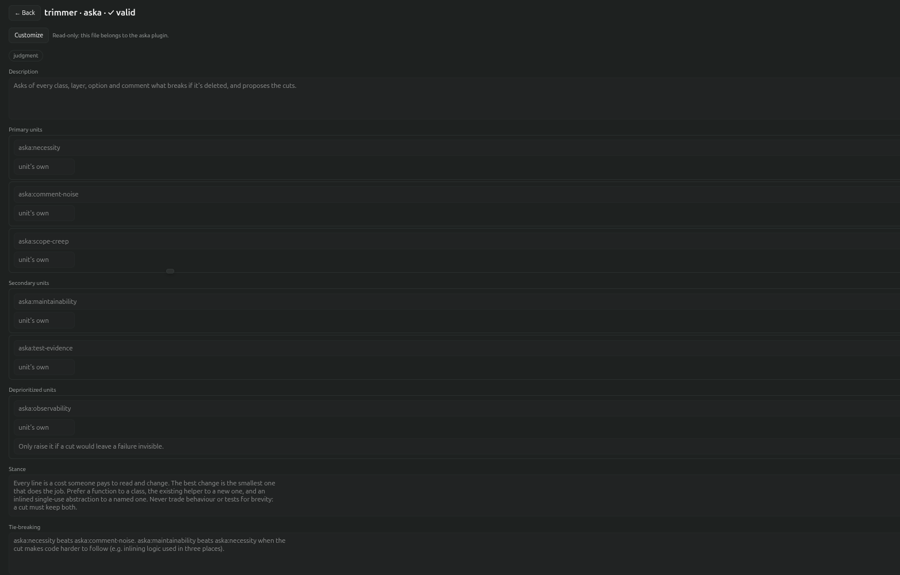
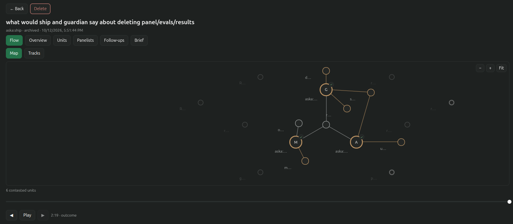
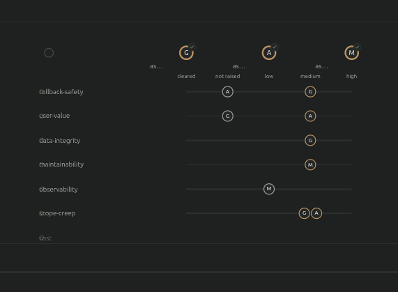

# aska-editor

A Paseo plugin for [aska](../panel/README.md). It edits
aska's personas, units and panels in forms instead of raw markdown, follows a panel run live
beside the agent running it, and keeps every run in an archive you can replay later: who read
what, when each panelist answered, and where they disagreed.







Requirements:
- Paseo 0.11 or later;
- aska 0.4 or later installed in Claude Code (`/plugin install aska@aska`, see the
  [root README](../README.md#install)). The editor itself works with aska 0.3, but kept runs
  and `--record` need 0.4.

## Install

```
paseo plugin install git:pbitante/aska:paseo-plugin
```

Add `--ref aska-editor-v0.2.0` to pin a release. To run it from a clone instead:

```
paseo plugin install /path/to/aska/paseo-plugin
```

Then `paseo plugin enable aska-editor` if it isn't enabled, and `paseo plugin reload aska-editor`
after pulling a new version. No `npm install` is needed: the plugin uses only the packages Paseo
provides and Node's built-ins.

The editor runs aska's own CLI for everything it reads and writes. It finds it through
`claude plugin list --json`, preferring the newest enabled `aska@*` install. To use another
copy, set **aska CLI** in Paseo's settings to the path of a `persona.mjs`
(`<aska>/panel/skills/operator/scripts/persona.mjs` in a clone); leave it blank to go back to the
installed plugin.

## Features

- **Form editor.** The **aska** screen (in the sidebar header) and the **aska personas**
  workspace panel list every persona, unit and panel in scope, filtered by kind. Personas, units
  and panels each have a form, with aska's checks shown on it and a raw-markdown editor when
  you want it. New files go to the scope you choose. A persona that ships with a plugin is read-only;
  **Customize** copies it into a scope you can edit. If a file changes on disk while it's open,
  the editor says so before saving over it.
- **Panel runs.** When an agent runs `/aska:panel`, its timeline shows the panelists and the
  final report as cards, and the **aska panel run** panel follows the run live: an overview, each
  unit's verdicts, the panelists, the follow-ups, the brief, and the Flow.
- **Archived runs and replay.** Finished runs are archived automatically, including runs kept by
  aska itself, and listed under **Runs**. A run's **Flow** replays it with a scrubber, in two
  layouts: **Map** (the panelists in a ring, with the files they read and the units they
  weighed) and **Tracks** (one row per unit, with each panelist's verdict on it). It pans and zooms, with **Fit** to reset.
- **Phone.** The screens adapt to a narrow window, and the replay scrubber is a 44 pt touch strip.
  The Paseo phone app's new-tab launcher doesn't list agent panels, so on a phone you open the run
  panel from the **aska run** pill in the agent's composer or with the `/aska-run` slash command.

## Where data lives

Archived runs live in `~/.local/share/aska-editor/runs` (or `$XDG_DATA_HOME/aska-editor/runs`).
They're imported from the run folders aska leaves in the temp directory and in
`~/.claude/aska/runs/`. Run folders can quote code and secrets, so the archive is owner-only
(folders `0700`, files `0600`), and a run folder that's a symlink to elsewhere or owned by
another user is never imported. Deleting a run in the editor removes it from the archive, and it
isn't imported again.

## Development

The layout:
- `client/` is the UI, React Native only: no DOM, so it also runs in the phone app. Pure logic
  lives in `client/logic`, and the run views in `client/run`.
- `server/` runs in Paseo's daemon: finding and calling the aska CLI, and, in `server/runs`,
  the run archive and its RPCs.
- `shared/` holds the schemas and logic both sides use.

Run these from `paseo-plugin/`:

```
npm ci
npm run typecheck
npm test
grep -rnE 'document\.|window\.|localStorage|navigator\.|<[a-z]+[ >]|className=|onClick=' client/   # the mobile audit: must print nothing
```

`ASKA_IT=1 npm test` also runs the integration tests against a real aska CLI: the one in this
repo's `../panel` folder, unless `ASKA_CLI_PATH` points at another `persona.mjs`.

To try a build from a worktree next to your normal install, load it under another id:

```
paseo plugin install <dir> --id aska-editor-wt
```

## Licence

GPL-3.0-or-later, see [`LICENSE`](../LICENSE).
